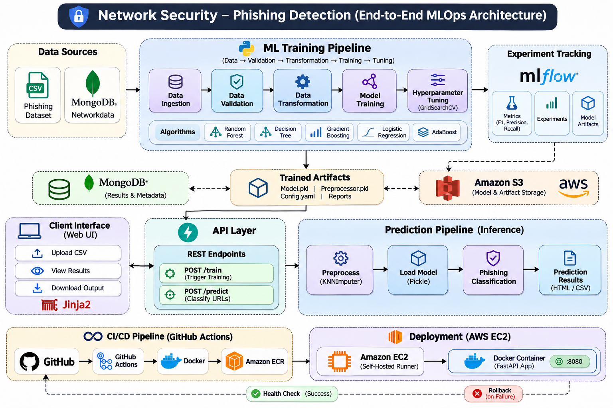
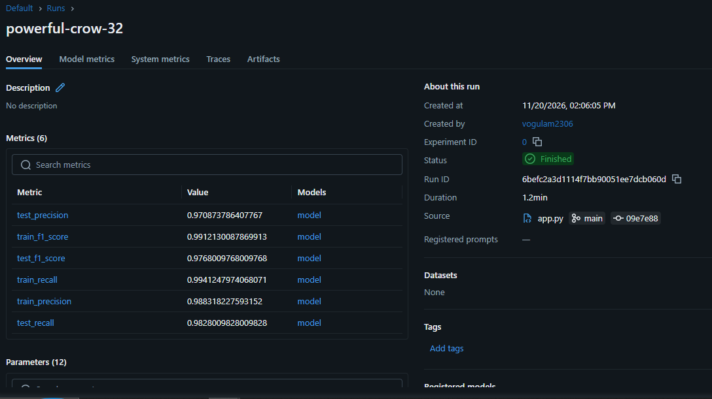
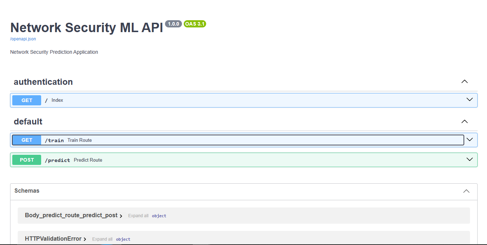
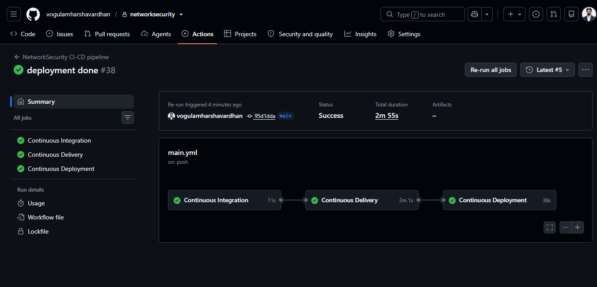

# Network Security – Phishing Website Detection


## Overview

An end-to-end machine learning project that detects phishing websites using website features. It covers data processing, model training, experiment tracking, prediction and automated deployment.

The application accepts a CSV file containing 30 pre-extracted website features and predicts whether each website is phishing or legitimate. It does not accept raw URLs directly.

## System Architecture



1. **Data ingestion:** Load data from MongoDB and split it into training and testing sets.
2. **Data validation:** Check the data schema and report data drift.
3. **Data transformation:** Handle missing values using KNN imputation.
4. **Model training:** Compare five ML algorithms and tune their hyperparameters with GridSearchCV.
5. **Experiment tracking:** Log model performance using MLflow and DagsHub.
6. **Prediction:** Use FastAPI and saved model artifacts to classify uploaded CSV records.
7. **Deployment:** Build Docker images, publish them to Amazon ECR and deploy through GitHub Actions to a self-hosted runner. Training artifacts can be synced to Amazon S3.

*The diagram is a conceptual overview. The actual training endpoint is `GET /train`; MongoDB stores source data, predictions are saved locally, and inference loads local model files. There is no separate download endpoint or automatic S3 model loading. EC2 is the illustrated deployment host.*

## Tech Stack

| Area | Technologies |
| --- | --- |
| Machine learning | Python, Pandas, NumPy, scikit-learn |
| Database | MongoDB |
| Experiment tracking | MLflow, DagsHub |
| API and interface | FastAPI, Jinja2 |
| Deployment | Docker, GitHub Actions, AWS ECR, S3, EC2 (illustrated host) |

## Dataset and Model Performance

- Dataset: **11,055 records and 30 input features**.
- Train/test split: 80:20.
- Models: Random Forest, Decision Tree, Gradient Boosting, Logistic Regression and AdaBoost.
- Hyperparameter tuning: GridSearchCV with 3-fold cross-validation.
- Bundled trained model: Random Forest.

| Metric | Training | Testing |
| --- | ---: | ---: |
| Precision | 98.83% | 97.09% |
| Recall | 99.41% | 98.28% |
| F1-score | 99.12% | **97.68%** |



*Recorded MLflow run `powerful-crow-32` (November 20, 2026). These results were not independently reproduced or linked to the bundled model. The current model selection uses test-set R², so the test results are not an independent final benchmark.*

## Getting Started

### 1. Install dependencies

Open a terminal in the project folder (Python 3.13).

```bash
python -m venv .venv
```

Activate the virtual environment: `.\.venv\Scripts\Activate.ps1` on Windows PowerShell, or `source .venv/bin/activate` on Linux/macOS.

```bash
python -m pip install -r requirements.txt
python -m pip install python-multipart jinja2
```

### 2. Configure MongoDB

Create a `.env` file in the project root with your MongoDB connection string:

```dotenv
MONGODB_URL_KEY=mongodb+srv://<username>:<password>@<cluster>/
MONGO_DB_URL=mongodb+srv://<username>:<password>@<cluster>/
```

Do not commit credentials. See the [setup guide](docs/SETUP.md) for model compatibility, database configuration and optional tracking setup.

### 3. Start the application

```bash
uvicorn app:app --host 127.0.0.1 --port 8080
```

Open [http://localhost:8080/docs](http://localhost:8080/docs).

To make a prediction, select `POST /predict`, click **Try it out**, upload `valid_data/test.csv` and click **Execute**. The API displays the results and saves them to `prediction_output/output.csv`.

To retrain locally, run `python push_data.py` once against a fresh MongoDB collection, then `python main.py`.

## FastAPI Interface



| Method | Endpoint | Purpose |
| --- | --- | --- |
| GET | `/` | Open Swagger UI |
| GET | `/train` | Trigger training and attempt S3 sync |
| POST | `/predict` | Upload a feature CSV and predict |

Keep the API private for now: the training endpoint does not require authentication.

## CI/CD and Deployment

The GitHub Actions workflow automates image building, delivery to Amazon ECR and deployment to a self-hosted runner (such as EC2).



All three jobs completed successfully in **2 minutes 55 seconds** in the supplied run. This does not establish current EC2 availability or automated test coverage (the CI test/lint commands are placeholders).

For Docker and AWS configuration, see the [deployment guide](docs/DEPLOYMENT.md).

## Project Structure

```text
networksecurity/
├── networksecurity/        # ML pipeline and utilities
├── network_data/           # Training dataset
├── data_schema/            # Feature schema
├── final_model/            # Saved model and preprocessor
├── valid_data/             # Example prediction input
├── templates/              # HTML prediction interface
├── .github/workflows/      # CI/CD workflow
├── docs/                   # Guides and screenshots
├── app.py                  # FastAPI application
├── main.py                 # Training script
├── push_data.py            # Import data into MongoDB
├── dockerfile              # Docker configuration
└── requirements.txt       # Dependencies
```
