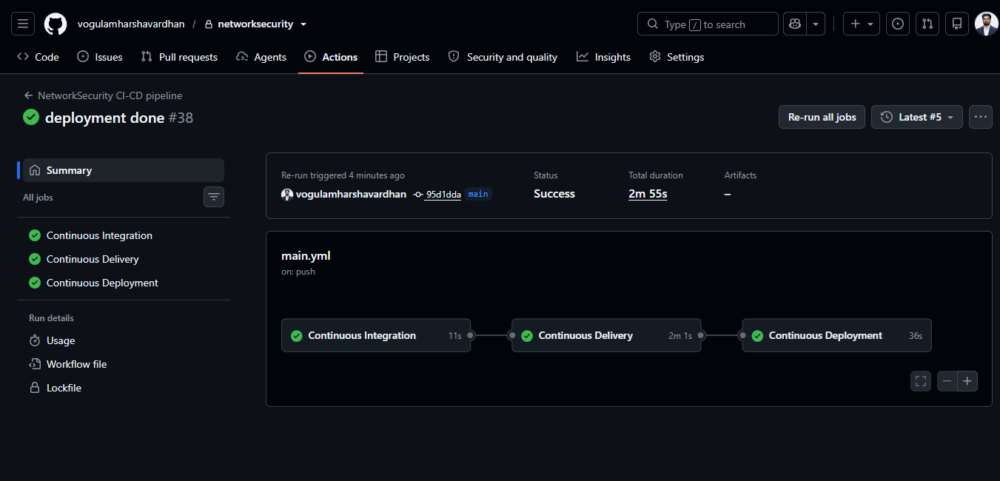

# Docker and AWS deployment

[← Back to project README](../README.md)

> The supplied GitHub Actions screenshot records a successful workflow run (#38, 2m 55s). Current service availability, the EC2 host and S3 object uploads have not been independently verified. Apply the documented fixes before production use.



## Docker

Before building, add `python-multipart` and `jinja2` to `requirements.txt` and create a `.dockerignore` file to prevent copying local secrets and virtual environments into the image:

```text
.env
.venv/
venv/
.git/
__pycache__/
logs/
```

Keep `final_model/` in the build context when using the bundled trained model. The existing Dockerfile is named `dockerfile` in lowercase, so explicitly specify it:

```bash
docker build -f dockerfile -t networksecurity:local .
docker run --rm -p 127.0.0.1:8080:8080 --env-file .env networksecurity:local
```

Open `http://localhost:8080/docs`. The container includes AWS CLI, but S3 access still requires an authorized runtime credential source. Local model or prediction files created in an ephemeral container are not durable unless persisted through a volume or external storage.

## AWS and GitHub Actions

The workflow is located in [`.github/workflows/main.yml`](../.github/workflows/main.yml). It runs on pushes to `main` (README-only changes are excluded).

1. **Continuous Integration:** checks out the source and executes placeholder lint/test messages.
2. **Continuous Delivery:** authenticates to Amazon ECR, builds the Docker image, and pushes commit-specific and latest tags.
3. **Continuous Deployment:** uses a self-hosted runner, pulls the image, validates application secrets, runs the container on port 8080, checks `/docs`, and attempts rollback on failure.

### Required GitHub Actions secrets

| Secret | Purpose |
|---|---|
| `AWS_ACCESS_KEY_ID` | AWS authentication in the current workflow. |
| `AWS_SECRET_ACCESS_KEY` | AWS authentication in the current workflow. |
| `AWS_REGION` | AWS region for ECR. |
| `ECR_REPOSITORY_NAME` | ECR repository name. |
| `MONGODB_URL_KEY` | Runtime MongoDB URI. |
| `MLFLOW_TRACKING_URI` | Remote tracking URL. |
| `MLFLOW_TRACKING_USERNAME` | Remote tracking username. |
| `MLFLOW_TRACKING_PASSWORD` | Remote tracking token/password. |

Although tracking is optional locally, the existing deployment workflow requires all three MLflow values to be non-empty. Configure the secrets under **Settings → Secrets and variables → Actions**.

### Deployment prerequisites and checks

- Create an ECR repository and an S3 bucket; update `TRAINING_BUCKET_NAME` in the pipeline constants to your bucket name.
- Register a Linux self-hosted GitHub Actions runner (for example, on EC2) with Docker, AWS CLI and curl installed, and grant the runner appropriate permissions.
- Provide least-privilege AWS access for ECR and S3. For S3 sync from the running application container, configure a separate runtime credential source, such as an appropriate EC2 IAM role. The workflow does not inject AWS access keys into the container.
- Change the workflow build command to `docker build -f dockerfile ...`, or rename the Dockerfile to `Dockerfile`, for portability on Linux.
- Ensure the old container is stopped before starting the replacement: renaming a running container does not release port 8080. Correct the rollback sequence before production use.
- Keep port 8080 restricted to trusted access until authentication and TLS are implemented.

The training orchestrator attempts to synchronize timestamped artifacts to `s3://<bucket>/artifact/<timestamp>/` and saved models to `s3://<bucket>/final_model/<timestamp>/`. Verify the objects independently after retraining.
